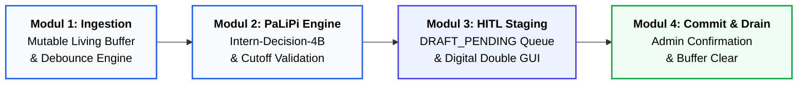
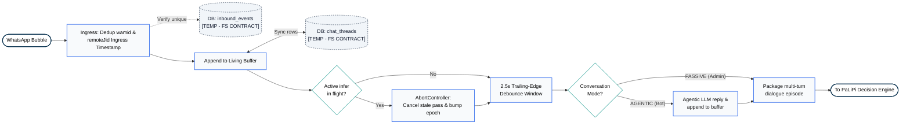
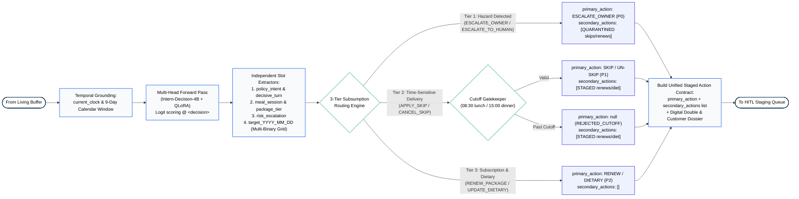

# AE_BIBLE.md: Application Engineering & Gen AI Technical Bible
**Namirims AI: Real-Time Passive Listening Multi-Turn Catering Decision Intelligence**  
*Asah 2026 Capstone Project — Application Engineering (AE) & Gen AI Track*

---

## 0. Matriks Kesenjangan Produksi & Pembagian Peran (Production Gaps & Handoff Matrix)

Tabel berikut memetakan status kapabilitas teknis sistem, kesenjangan operasional (*production gaps*), serta mandat peran eksplisit antar-jalur (**Application Engineering / AE**, **Data Science / DS**, dan **Full-Stack / FS**):

| # | Dimensi Kebutuhan | Kesenjangan Produksi Riil (*Production Reality*) | Pemilik Tanggung Jawab (*Owner*) | Rencana Tindak Lanjut Teknis (*Action Item*) |
|---|---|---|---|---|
| **1** | **Jeda Makan Non-Konsekutif (Mahasiswa Komuter / Hybrid)** | Mahasiswa tingkat 4 / komuter PP Jabodetabek membutuhkan jeda non-berurutan (*"skip Senin & Kamis"*). Model v3 dilatih pada 1.700 skenario standar. | **Application Engineering (AE)** | Bangun `datasets/sealed/commuter_stress_50.jsonl` untuk mengukur zero-shot v3 vs v3.1 pasca-benchmark 600 sealed. Dataset training 1.740 (`training_set_1740.jsonl`) sudah disiapkan. |
| **2** | **Ekstraksi Pantangan Diet (NER)** | Catatan diet tidak terstruktur menyulitkan dapur memfilter bahan alergen umum (udang, kacang, telur, susu, gluten). | **Data Science (DS)** | Bangun modul *Named Entity Recognition (NER)* atau *Food Allergen Slot Filler* berbasis taksonomi baku (`allergens: ["udang", "kacang"]`). |
| **3** | **Prediksi Kebutuhan Porsi Dapur (Demand Forecasting)** | Dapur UMKM membutuhkan estimasi jumlah porsi masak harian 7 hari ke depan untuk belanja bahan baku dan mitigasi food waste. | **Data Science (DS)** | Analisis data historis katering menggunakan model *Time-Series Forecasting* (Prophet / LightGBM) untuk memprediksi fluktuasi porsi per asrama. |
| **4** | **Kontekstualisasi Kuota Pelanggan (Context Hydration)** | Model tidak membaca sisa kuota pelanggan langsung dari DB sebelum inferensi, berisiko menyetujui mutasi paket saat kuota 0 porsi. | **Full-Stack (FS) & Application Engineering (AE)** | Implementasi *Step 1: Context Hydration (<50ms)* pada backend untuk menyuntikkan sisa kuota riil dan status langganan ke dalam *system prompt* sebelum inferensi. |
| **5** | **Segmentasi Percakapan Lintas Hari (Cross-Day Dialogue)** | Percakapan menggantung dari malam sebelumnya dapat membingungkan resolusi tanggal relatif (*"besok"* vs *"hari ini"*). | **Application Engineering (AE)** | Penegakan segmentasi *session timeout* (membagi episode jika jeda >12 jam) dan penegakan timestamp pesan asli pada *decisive turn*. |

---

## 1. Inti Riset: Arsitektur Passive Listening Pipeline

### A. Mengapa Passive Listening (Bukan Chatbot Aktif)?
Dalam operasional katering WhatsApp UMKM, chatbot interaktif sering kali mengganggu hubungan personal antara pemilik UMKM dengan pelanggan:
- Pelanggan merasa frustrasi jika dipaksa berbicara dengan bot formulaik kaku (*"Ketik 1 untuk skip..."*).
- Pemilik katering tetap ingin membalas pesan mahasiswa secara hangat dan personal.
- **Solusi Riset AE**: **Passive Listening Mode (PaLiPi Model - Passive Listening Pipeline Model)**. Sistem bertindak sebagai pengamat senyap (*silent background observer*) di dalam webhook WhatsApp:
  1. Mendengarkan seluruh balon obrolan yang mengalir bolak-balik antara Mahasiswa dan Admin secara utuh dalam satu episode percakapan.
  2. Menggunakan **Mutable Buffer (Interruptible Ingestion)**: Balon pesan terfragmentasi dihimpun ke dalam buffer aktif. Jika ada bubble baru masuk saat inferensi berlangsung, pipeline membatalkan proses lama (*AbortController*), memperbarui buffer, dan melakukan inferensi ulang.
  3. Mengadopsi prinsip **Propose-Validate-Execute (PVE)**: PaLiPi tidak pernah langsung memutasi database jadwal dapur. Seluruh hasil keputusan model wajib masuk ke **Human-In-The-Loop (HITL) Queue** sebagai draf aksi (*staged action proposal*).
  4. Memvalidasi batasan jam operasional (*cutoff* jam 08:30 siang & 15:00 malam WIB) secara deterministik pada gerbang kode, bukan diserahkan pada halusinasi LLM.
  5. Menyediakan **Digital Double** riwayat percakapan beserta berkas informasi pelanggan (*customer dossier*: alergi, sisa kuota, asrama) pada antarmuka HITL untuk mempermudah admin memverifikasi dan menyetujui aksi dengan 1-klik.

### B. Diagram Arsitektur AI End-to-End Terpadu (Full AI System Architecture)

Diagram berikut merangkum seluruh alur arsitektur AI dari penanganan pesan masuk (*ingress*), perutean dual-mode, *mutable living buffer*, inferensi neural terarah PaLiPi, hingga penegakan antrean review HITL dan pengosongan buffer (*buffer drain*):

```mermaid
flowchart LR
    classDef nodeStyle fill:#FFFFFF,stroke:#2563EB,stroke-width:1.5px,color:#0F172A;
    classDef neuralStyle fill:#EEF2FF,stroke:#4F46E5,stroke-width:2px,color:#1E1B4B;
    classDef hitlStyle fill:#FEF3C7,stroke:#D97706,stroke-width:1.5px,color:#78350F;
    classDef commitStyle fill:#F0FDF4,stroke:#16A34A,stroke-width:2px,color:#14532D;

    classDef dbStyle fill:#F1F5F9,stroke:#475569,stroke-width:1.5px,stroke-dasharray: 3 3,color:#0F172A;

    subgraph SG1 ["<b>1. Ingress &amp; Mode Router</b>"]
        WA([Inbound WhatsApp]):::nodeStyle --> Dedup["Ingress Gateway<br/>(wamid Dedup)"]:::nodeStyle
        Dedup -.->|"Check UNIQUE(wamid)"| DB_Dedup[("DB: inbound_events<br/>[TEMP - FS CONTRACT]")]:::dbStyle
        Dedup --> ModeSwitch{"Mode Router<br/>(Schedule + Override)"}:::nodeStyle
        ModeSwitch -.->|"Read setting"| DB_Config[("DB: system_settings<br/>[TEMP - FS CONTRACT]")]:::dbStyle
        ModeSwitch -->|"PASSIVE (Siang)"| PassiveObs["Passive Copilot<br/>(Admin Typing)"]:::nodeStyle
        ModeSwitch -->|"AGENTIC (Malam)"| AgentTwoStep["2-Step Agentic Bot<br/>(Retrieve-then-Generate)"]:::nodeStyle
    end

    subgraph SG2 ["<b>2. Mutable Living Buffer</b>"]
        PassiveObs --> IngestBuf["Living Buffer Engine"]:::nodeStyle
        AgentTwoStep --> IngestBuf
        IngestBuf <-->|"Append / Read"| DB_Buf[("DB: chat_threads<br/>[TEMP - FS CONTRACT]")]:::dbStyle
        IngestBuf --> MidInfer{"In-Flight<br/>Inferring?"}:::nodeStyle
        MidInfer -->|Yes| AbortSig["AbortController<br/>(Cancel &amp; Bump Epoch)"]:::nodeStyle
        MidInfer -->|No| Debounce["2.5s Trailing-Edge<br/>Debounce Window"]:::nodeStyle
        AbortSig --> Debounce
    end

    subgraph SG3 ["<b>3. PaLiPi Neural Causal Engine</b>"]
        Debounce --> Ground["Temporal Grounding<br/>(Calendar Window up to 9d)"]:::neuralStyle
        Ground --> MultiHead["Intern-Decision-4B + QLoRA<br/>Multi-Head Causal Grid Logit Scoring<br/>(intent, session, risk, tier, turn, target_dates)"]:::neuralStyle
        MultiHead --> Subsume["Subsumption &amp; Preemption Engine<br/>Tier 1: Safety &amp; Emergency (P0)<br/>Tier 2: Cutoff Time-Sensitive Skip (P1)<br/>Tier 3: Subscription &amp; Dietary (P2)"]:::neuralStyle
        Subsume --> Gatekeeper["Deterministic Gate<br/>(Cutoff 08:30/15:00 &amp; SKU Catalog)"]:::neuralStyle
    end

    subgraph SG4 ["<b>4. HITL Queue &amp; Buffer Drain</b>"]
        Gatekeeper --> StagedDraft["Staged Action Proposal Contract<br/>primary_action + secondary_actions<br/>+ Digital Double &amp; Dossier"]:::hitlStyle
        StagedDraft --> UpsertQueue["UPSERT Draft<br/>(status: DRAFT_PENDING)"]:::hitlStyle
        UpsertQueue <-->|"UPSERT Draft"| DB_HITL[("DB: hitl_queue<br/>[TEMP - FS CONTRACT]")]:::dbStyle
        ReviewGUI["Admin Review GUI<br/>(Zero-Vomiting Rule)"]:::hitlStyle
        DB_HITL -.->|"Read Draft"| ReviewGUI
        ReviewGUI -->|"1-Click Approve"| CommitAll["Execute Commit:<br/>1. Write Manifest<br/>2. Send Outbox Receipt<br/>3. Drain Living Buffer"]:::commitStyle
        CommitAll -->|"INSERT / UPDATE"| DB_Manifest[("DB: catering_deliveries<br/>[TEMP - FS CONTRACT]")]:::dbStyle
        CommitAll -->|"DELETE / RESET"| DB_Buf
    end

    style SG1 fill:#F8FAFC,stroke:#94A3B8,stroke-width:1px
    style SG2 fill:#F8FAFC,stroke:#94A3B8,stroke-width:1px
    style SG3 fill:#EEF2FF,stroke:#818CF8,stroke-width:1.5px
    style SG4 fill:#FFFBEB,stroke:#FCD34D,stroke-width:1.5px
```



---

### C. Arsitektur Makro PaLiPi (Top-Level Macro Pipeline)

Secara makro, seluruh interaksi WhatsApp dialirkan melalui 4 modul terisolasi (*decoupled*):



---

### D. Dekomposisi Sub-Pipeline

#### 1. Sub-Pipeline 1: Ingestion &amp; Mutable Living Buffer Lifecycle
Menangani fragmentasi chat WhatsApp (*burst chat*), pembatalan komputasi usang (*mid-inference interruption*), dan perutean dual-mode secara horizontal:



#### 2. Sub-Pipeline 2: Two-Step Agentic Bot Lifecycle (Night / Inactive Window)
Menangani interaksi otonom saat admin *offline* (malam hari/luar jam operasional) menggunakan pola **Retrieve-then-Generate** untuk mengeliminasi halusinasi data kuota/menu:

```mermaid
flowchart LR
    classDef proc fill:#F8FAFC,stroke:#2563EB,stroke-width:1.5px,color:#0F172A;
    classDef dec fill:#FFFFFF,stroke:#0D9488,stroke-width:1.5px,color:#0F172A;
    classDef llm fill:#EEF2FF,stroke:#4F46E5,stroke-width:1.5px,color:#1E1B4B;
    classDef db fill:#F1F5F9,stroke:#475569,stroke-width:1.5px,stroke-dasharray: 3 3,color:#0F172A;
    classDef term fill:#FFFFFF,stroke:#002B49,stroke-width:2px,color:#000;

    InAg([From Mode Router: AGENTIC]):::term --> Step1["<b>Step 1: TDM Context Selector</b><br/>(Fast Classifier / PaLiPi)<br/>Extracts required dependencies"]:::llm
    Step1 --> SpecJSON["Dependency Contract:<br/>{need_quota, need_cutoff, need_menu}"]:::proc
    SpecJSON --> Hydrate["<b>Deterministic Hydration (&lt;50ms)</b><br/>SQL Indexed Read Queries"]:::proc
    Hydrate <-->|"Fetch facts"| DB_Cust[("DB: customer_profiles &amp; packages<br/>[TEMP - FS CONTRACT]")]:::db
    Hydrate --> GroundContext["Ground Truth Context:<br/>Quota=4, Cutoff=Open, Allergy=Shrimp"]:::proc
    GroundContext --> Step2["<b>Step 2: Grounded Reply Generator</b><br/>(Conversational LLM)<br/>System Prompt + Ground Truth Context"]:::llm
    Step2 --> DispatchOut["Send WhatsApp Reply to User<br/>&amp; Append Bot Message to Living Buffer"]:::proc
    DispatchOut --> OutAg([To PaLiPi Decision Engine]):::term
```



#### 3. Sub-Pipeline 3: PaLiPi Neural Causal Decision &amp; Cutoff Engine
Mengekstrak niat bisnis binding dan penanggalan berbasis kalender temporal secara deterministik:



#### 4. Sub-Pipeline 4: Strict HITL Staging &amp; Living Buffer Drain Lifecycle (Zero-Vomiting Rule)
Menegakkan aturan mutasi: **Semua data wajib di-ingest (tidak pernah dibuang/di-vomit)**. Living buffer **hanya dibersihkan saat admin telah mengonfirmasi/menyelesaikan review**:

```mermaid
flowchart LR
    classDef proc fill:#F8FAFC,stroke:#2563EB,stroke-width:1.5px,color:#000;
    classDef dec fill:#FFFFFF,stroke:#0D9488,stroke-width:1.5px,color:#000;
    classDef db fill:#F1F5F9,stroke:#475569,stroke-width:1.5px,stroke-dasharray: 3 3,color:#0F172A;
    classDef action fill:#F0FDF4,stroke:#16A34A,stroke-width:2px,color:#000;
    classDef term fill:#FFFFFF,stroke:#002B49,stroke-width:2px,color:#000;

    InP3([From PaLiPi]):::term --> UpsertQueue["Dynamic SQL UPSERT Draft<br/>(status: DRAFT_PENDING)"]:::proc
    UpsertQueue --> DB_HITL[("DB: hitl_queue<br/>[TEMP - FS CONTRACT]")]:::db
    DB_HITL --> HITLGUI["Admin Reviews in HITL GUI<br/>(Digital Double + Dossier)"]:::proc
    DB_Buf[("DB: chat_threads [TEMP]<br/>(Buffer Retained)")]:::db -.->|"Render transcript"| HITLGUI

    HITLGUI --> AdminAction{"Admin Action<br/>(Zero-Vomiting)"}:::dec
    AdminAction -->|"Sesuai"| ApproveDirect["1-Click Approve"]:::action
    AdminAction -->|"Koreksi"| ManualEdit["Admin edits dates/session<br/>directly in GUI"]:::proc
    ManualEdit --> ApproveDirect

    ApproveDirect --> CommitManifest["1. Commit Deliveries<br/>2. Send Outbox Receipt<br/>3. Update hitl_queue = COMMITTED"]:::action
    CommitManifest --> DB_Delivery[("DB: catering_deliveries<br/>[TEMP - FS CONTRACT]")]:::db
    CommitManifest --> DrainBuffer["<b>DRAIN &amp; CLEAR Living Buffer</b><br/>(DELETE FROM chat_threads)"]:::proc
    DrainBuffer --> EndNode([Episode Finalized]):::term
```



---

### E. Arsitektur Multi-Policy & Routing Subsumpsi (Multi-Policy Causal Decision Grid)
Di dalam `Pipeline_MultiPolicy.py`, model tidak lagi dibatasi pada satu intent tunggal yang saling lepas (*single-label mutual exclusion*). Sebagai gantinya, sistem menggunakan **Multi-Head Independent Decision Grid** yang mampu mengekstrak multi-aksi secara simultan (misal: *skip* + *renew* + *catatan alergi*) dengan penegakan **Hirarki Subsumpsi (Subsumption Architecture)** demi keselamatan pangan:

1. **Multi-Head Independent Slot Scoring**:
   - Model mengevaluasi seluruh pertanyaan secara terpisah dalam satu forward pass logit:
     - `policy_intent`: Intensi utama obrolan (`APPLY_SKIP`, `CANCEL_SKIP`, `UPDATE_DIETARY`, `RENEW_PACKAGE`, `ESCALATE_OWNER`, `NEEDS_REVIEW_CLARIFY`, `QUERY_ONLY`).
     - `meal_session`: Sesi makan (`lunch`, `dinner`, `both`).
     - `risk_escalation`: Level risiko darurat (`SAFE_AUTOMATED`, `ESCALATE_TO_HUMAN`).
     - `package_tier`: SKU paket langganan yang disebut (`hemat`, `bulanan`, dll).
     - `decisive_turn`: Penanda balon pesan penentu keputusan akhir (`turn_0` s/d `turn_4`).
     - `target_YYYY_MM_DD`: Grid biner (`YES` / `NO`) independen untuk setiap hari dalam jendela kalender operasional (hingga 9 hari ke depan).
2. **Hirarki Subsumpsi 3-Tingkat (Subsumption Routing Engine)**:
   - **Tier 1 (P0 - Critical Safety & Emergency)**:
     Jika terdeteksi bahaya fisik (staples, beling, keracunan) atau komplain darurat (`ESCALATE_OWNER` / `ESCALATE_TO_HUMAN`), sistem langsung menetapkan `primary_action = ESCALATE_OWNER` dan membungkam bot. Seluruh mutasi jadwal katering ditangguhkan, namun permohonan skip/renew pelanggan tetap dicatat sebagai `secondary_actions` dengan status `QUARANTINED_PENDING_SAFETY_CLEARANCE`.
   - **Tier 2 (P1 - Cutoff Time-Sensitive Logistics)**:
     Jika ada permohonan libur makan (`APPLY_SKIP` / `CANCEL_SKIP`), tanggal dan jam divalidasi ke batas operasional (08:30 lunch, 15:00 dinner). Jika valid, permohonan dijadikan `primary_action`. Permintaan lain (seperti perpanjangan paket atau diet) ditampung sebagai `secondary_actions` dengan status `STAGED` / `RECORDED`.
   - **Tier 3 (P2 - Subscription & Dietary Records)**:
     Jika tidak ada jadwal skip, perpanjangan paket (`RENEW_PACKAGE`) atau preferensi diet (`UPDATE_DIETARY`) diproses sebagai aksi primer.

### F. Taksonomi & Definisi Resmi Policy Intent
Definisi operasional intent di dalam `Pipeline_MultiPolicy.py`:

| Policy Intent | Deskripsi Semantik & Operasional | Kriteria Pemicu (*Trigger Condition*) | Output Aksi Sistem |
|:---|:---|:---|:---|
| `APPLY_SKIP` | Permintaan libur makan / jeda pengiriman porsi. | Mahasiswa meminta penghentian kirim katering untuk tanggal & sesi tertentu (misal: *"min besok siang libur dulu ya"*). | Tanggal divalidasi ke kalender; porsi dapur dikurangi jika sebelum cutoff. |
| `CANCEL_SKIP` | Pembatalan libur makan (resume / un-skip). | Mahasiswa yang sebelumnya libur ingin kembali makan normal (misal: *"min gajadi libur ya besok, tetep kirim ke kosan"*). | Tanggal diaktifkan kembali di daftar saji katering jika sebelum cutoff. |
| `UPDATE_DIETARY` | Perubahan preferensi makanan, pantangan, atau alergi. | Mahasiswa memperbarui status medis/pantangan makan (misal: *"min mulai besok jangan pake udang ya, alergi"*). | `dietary_notes` dicatat tanpa memotong jadwal porsi. |
| `RENEW_PACKAGE` | Konfirmasi perpanjangan atau pembelian paket katering. | Mahasiswa ingin memperpanjang paket langganan (hemat, nikmat, bulanan, dll) dan/atau mengirim bukti transfer. | Verifikasi SKU paket katalog; pembaruan kuota langganan di database. |
| `ESCALATE_OWNER` | Laporan insiden bahaya fisik, makanan basi, atau komplain kritis. | Ditemukan benda asing berbahaya (staples, pecahan kaca, serangga/ulat), keracunan, atau ancaman viral media sosial. | **Hak Veto Tertinggi (Preemptive)**: Mengesampingkan aksi lain, menerbitkan tiket darurat P0 ke pemilik UMKM. |
| `NEEDS_REVIEW_CLARIFY` | Niat belum bulat, ragu-ragu, atau informasi tidak lengkap. | Mahasiswa masih ragu (*"liat ntar sorean ya min"*), atau tanggal/sesi tidak jelas. | Draf HITL berstatus `CLARIFICATION_REQUIRED` (`dates = []`). |
| `QUERY_ONLY` | Percakapan umum atau pertanyaan non-transaksional. | Menanyakan jadwal menu hari ini, harga paket, biaya ongkir, jam antar, atau sapaan ramah. | Dicatat ke log obrolan; draf HITL berstatus `PROCESSED_QUERY`. |
| `None` (Rejection) | Permintaan sah namun melanggar batas jam operasional (*cutoff*). | Permintaan libur hari H dikirim pada/setelah jam 08:30 (siang) atau 15:00 (malam). | Draf HITL berstatus `REJECTED_CUTOFF`; porsi tetap wajib dimasak dapur kecuali admin memberi diskresi. |

### G. Arsitektur Dual-Mode & Living Draft Buffer (PaLiPi Model)

Untuk menjamin keandalan sistem produksi tanpa risiko halusinasi atau mutasi ganda (*split-brain*), arsitektur PaLiPi menerapkan empat pilar desain:

#### 1. Prinsip Propose-Validate-Execute (PVE)
Baik PaLiPi (Passive Mode) maupun Bot Otomatis (Agentic Mode) **dilarang keras memutasi langsung tabel manifes produksi dapur (`catering_deliveries`)**.
- Model hanya bertindak sebagai generator proposal terstruktur (*Draft Proposal*).
- Proposal diperiksa oleh gerbang deterministik (*Deterministic Gatekeeper*) untuk validasi jam *cutoff* (08:30/15:00 WIB) dan otentikasi identitas WhatsApp (`remoteJid`).
- Seluruh keluaran keputusan **wajib bermuara ke tabel `hitl_queue` (Human-in-the-Loop)** untuk ditinjau oleh pengelola UMKM.

#### 2. Mutable Living Buffer & Interruptible Ingestion
Dalam percakapan WhatsApp nyata, mahasiswa mengirim pesan secara terpotong-potong (*fragmented bursts*, misal: *"Min"* $\to$ *"Mau libur besok"* $\to$ *"Eh gajadi besok, jumat aja min"*).
- **Ingestion per-Episode, Bukan per-Balon**: PaLiPi tidak mengeksekusi inferensi pada setiap satu gelembung pesan individual (*isolated bubble*), melainkan mengumpulkan pesan ke dalam blok buffer aktif per sesi percakapan (`chat_threads`).
- **Debouncing Trailing-Edge**: Menggunakan *sliding timer* 2.5 detik untuk menunggu apakah ada balon pesan susulan sebelum memicu inferensi model 4B.
- **Mid-Inference Interruption**: Jika ada pesan baru masuk saat PaLiPi sedang menjalankan komputasi forward pass, sinyal pembatalan (*AbortController* / peningkatan *monotonic cancellation epoch*) seketika menghentikan inferensi lama, menambahkan pesan baru ke buffer, dan menjadwalkan ulang inferensi.
- **Dynamic UPSERT Draf HITL**: Hasil inferensi buffer aktif disimpan ke `hitl_queue` menggunakan mekanisme SQL `UPSERT`:
  ```sql
  INSERT INTO hitl_queue (customer_id, action_type, target_dates, session, confidence, status, gui_dossier)
  VALUES ($1, $2, $3, $4, $5, 'DRAFT_PENDING', $6)
  ON CONFLICT (customer_id) WHERE status = 'DRAFT_PENDING'
  DO UPDATE SET
      action_type = EXCLUDED.action_type,
      target_dates = EXCLUDED.target_dates,
      session = EXCLUDED.session,
      confidence = EXCLUDED.confidence,
      gui_dossier = EXCLUDED.gui_dossier,
      updated_at = NOW();
  ```
  Hal ini mencegah penumpukan tiket duplikat di dasbor admin; tiket draf pelanggan otomatis menyesuaikan diri mengikuti ralat percakapan terbaru.
- **Zero-Vomiting & Buffer Drain Policy**:
  - **Seluruh Pesan Wajib Di-ingest (Zero Drop/Vomit)**: Sistem tidak mengenal status "hapus tiket tanpa ingest" atau membuang data begitu saja. Bahkan jika percakapan mengandung keraguan (*NEEDS_REVIEW_CLARIFY*) atau melanggar cutoff (*REJECTED_CUTOFF*), tiket tetap di-ingest ke HITL.
  - **Koreksi Langsung oleh Admin**: Jika AI mengekstrak data yang kurang akurat atau ada kondisi khusus di luar dugaan, admin mengoreksi tanggal/sesi secara langsung di formulir HITL GUI sebelum menekan tombol konfirmasi.
  - **Siklus Pembersihan Buffer (Buffer Drain)**: Living buffer di tabel `chat_threads` **hanya dibersihkan/direset saat admin telah menekan konfirmasi final (Approve/Commit)** pada dasbor review. Selama sesi percakapan belum dikonfirmasi admin, buffer tetap hidup dan terus mengakumulasi konteks obrolan.

#### 3. Penyatuan Batas Dual-Mode (Passive vs Agentic)
Sistem memisahkan peran **Mulut (Bicara/Komunikasi)** dan **Otak (Keputusan Bisnis)** untuk menjamin konsistensi mutasi:
- **Mode A (Passive Listening)**: Berjalan saat Admin manusia aktif di jam kerja. PaLiPi mengamati obrolan secara senyap di latar belakang dan memperbarui draf tiket HITL tanpa mengirim pesan keluar.
- **Mode B (Agentic Mode)**: Berjalan saat admin tidak aktif (misal malam hari). Bot AI membalas pesan mahasiswa secara otonom, namun **dilarang memegang tool mutasi database langsung**; bot hanya memiliki *Read Tools* dan memanggil *proposal tool* (`propose_action()`).
- **Mode C (Escalated/Human Takeover)**: Jika ditemukan bahaya makanan atau komplain kritis (`ESCALATE_OWNER`), bot langsung dibungkam (*hard mute*) dan tiket prioritas tertinggi (P0) diterbitkan ke pengelola.

##### A. Mekanisme Mode Switching (Jadwal & Master Toggle Dashboard)
Alih-alih mengandalkan indikator `typing` WhatsApp yang tidak andal (di mana admin manusia selalu kalah cepat dengan kecepatan respons bot), switching mode dikendalikan secara deterministik:
1. **Operating Hours Schedule**: Default jam operasional (misal `08:00 - 21:00 WIB` = Mode `PASSIVE`, dan `21:00 - 08:00 WIB` = Mode `AGENTIC`).
2. **Dashboard Master Override Switch**: Tombol toggle global maupun per-ruang chat di dasbor admin (`AGENT_ACTIVE = false/true`). Jika disetel `false`, gateway memblokir 100% respons otomatis bot tanpa memandang jam.

##### B. Arsitektur Two-Step Agentic: "Retrieve-then-Generate" (Anti-Lazy Hallucination)
Membiarkan LLM agentic memanggil tool dalam satu loop ReAct bebas rawan menimbulkan *lazy hallucination* (agen malas mengecek database dan langsung menjawab berdasarkan asumsi keliru mengenai kuota atau menu). Untuk mengatasinya, agen beroperasi dalam 2 tahap terstruktur:
1. **Step 1 (TDM & Context Selector)**: Model klasifikasi cepat / PaLiPi mengevaluasi pesan dan menentukan dependensi data yang dibutuhkan:
   ```json
   { "need_quota": true, "need_menu": false, "need_cutoff": true, "target_date": "2026-11-04" }
   ```
2. **Deterministic Context Hydration (<50ms)**: Backend mengeksekusi kueri terindeks langsung ke PostgreSQL untuk mengambil fakta riil pelanggan (sisa kuota: 4 porsi, status cutoff: BUKA, riwayat alergi: udang).
3. **Step 2 (Grounded Reply Generation)**: Fakta riil disuntikkan ke dalam *system prompt* sebagai *ground truth context*. LLM percakapan murni fokus menyusun kalimat balasan yang ramah, natural, dan terbebas dari halusinasi data kuota/jadwal, sekaligus memicu pembaruan draf di `hitl_queue` (`status = 'DRAFT_PENDING'`).

#### 4. Human-In-The-Loop (HITL) GUI: Purpose-Built SI Tooling, Pre-Filled Fields, & Zero Alt-Tab
Sistem Informasi (SI) Admin Katering dirancang khusus untuk memecahkan *root cause* utama kegagalan operasional: **admin sering lupa menginput data ke spreadsheet umum karena kelelahan berganti-ganti aplikasi (*context-switching fatigue*) antara WhatsApp dan lembar Excel**. 

Arsitektur antarmuka tinjauan menerapkan tiga prinsip interaksi:
1. **Automatic Pre-Filled Fields (Pengisian Formulir Otomatis)**:
   PaLiPi bertindak sebagai *ingestion engine* di balik layar. Admin tidak pernah membuka formulir kosong; seluruh atribut aksi (`action: APPLY_SKIP`, `target_dates: ['2026-11-04']`, `meal_session: 'lunch'`, `dietary_notes: 'tanpa pedas'`) langsung **terisi otomatis secara presisi** ke dalam kolom-kolom input draf.
2. **Side-by-Side Split-Screen Ingestion (Zero Alt-Tab)**:
   Admin tidak perlu bolak-balik membuka WhatsApp dan SI katering. Kartu tiket antrean draf menyajikan tampilan berdampingan:
   - **Sisi Kiri**: Cuplikan percakapan asli yang di-ingest (*Chat Snippet / Digital Double*), waktu kirim per balon chat, serta ringkasan profil pelanggan (*Customer Dossier*: sisa kuota, riwayat alergi, lokasi asrama).
   - **Sisi Kanan**: Formulir hasil inferensi AI yang telah terisi otomatis (*Pre-Filled Form*).
3. **Frictionless Inline Adjustment & 1-Click Commit**:
   - Jika hasil pembacaan AI sudah tepat (akurasi model >91%), admin cukup melakukan **1-Click Approve** untuk memasukkan data ke manifes dapur.
   - Jika terdapat permintaan ambigu atau perubahan menit-menit akhir oleh pelanggan, admin dapat **mengedit langsung kolom dropdown tanggal/sesi secara inline** tanpa mengetik ulang dari awal.
   - Setelah disetujui, sistem memutasi database manifes dapur (`catering_deliveries`), mengosongkan antrean draf, dan mengirimkan resi konfirmasi via WhatsApp Outbox.

---

### H. Pembagian Peran Sesuai Playbook Asah 2026
- **Application Engineering / Gen AI (AE)**:
  1. **Custom Model**: Fine-tuning *Small Language Model* (`Intern-Decision-4B` via QLoRA 4-bit) untuk penalaran keputusan multi-turn terarah.
  2. **Pipeline Mandiri**: Mengemas seluruh inferensi ke dalam `Pipeline_MultiPolicy.py` (self-contained, multi-head causal decision grid, zero-dependency ke folder eksternal).
  3. **Komparasi Model**: Membandingkan performa model dasar vs fine-tuned pada **600 skenario Blind Sealed Testset** (`datasets/sealed/`).
  4. **Efisiensi Perangkat Keras**: Menjamin peak VRAM < 4 GB (cap 8 GB RTX 4060) dan latensi p95 < 1.5 detik.
- **Data Science (DS)**:
  1. **Data Wrangling Historis**: Analisis data transaksi UMKM asli (`2026-2027 Catering Namirims.xlsx`).
  2. **Forecasting**: 7-day demand forecasting kebutuhan porsi harian (Prophet / LightGBM) untuk memitigasi pemborosan bahan dapur.
  3. **Visualisasi**: Widget interaktif untuk dashboard web Admin Full-Stack.

---

## 2. Hasil Temuan Riset (Research Pipeline Outcomes)

Hasil benchmarking komparatif komprehensif pada **600 Skenario Blind Sealed Testset** (400 baseline, 100 compound multi-policy, 100 adversarial):

### A. Tabel Hasil Perbandingan Konfigurasi Model (600 Sealed Scenarios)
| Evaluasi Split | Metrik Evaluasi | Base Model (Zero-Shot) | LoRA v1 (1.200 Anchor) | LoRA v3 (1.700 Balanced) |
|:---|:---|:---:|:---:|:---:|
| **Multipolicy Sealed (100)** | Exact Match (%)<br/>Action Accuracy (%)<br/>Dates Accuracy (%) | 52.00%<br/>77.00%<br/>55.00% | 90.00%<br/>96.00%<br/>94.00% | *In Training (Colab A100)*<br/>*Target: ≥94.0% Exact* |
| **Adversarial Sealed (100)** | Exact Match (%)<br/>Action Accuracy (%)<br/>Dates Accuracy (%) | 60.00%<br/>63.00%<br/>79.00% | 78.00%<br/>79.00%<br/>91.00% | *In Training (Colab A100)*<br/>*Target: ≥85.0% Exact* |
| **Baseline Sealed (400)** | Exact Match (%)<br/>Action Accuracy (%)<br/>Dates Accuracy (%) | 64.25%<br/>67.25%<br/>83.75% | 92.50%<br/>93.75%<br/>94.50% | *In Training (Colab A100)*<br/>*Target: ≥94.0% Exact* |
| **All 600 Sealed Combined** | **Overall Exact Match (%)** | **61.50%** | **89.67%** | **Target: ≥93.50%** |
| | **Peak VRAM / Device** | 3.58 GB (T4) | 3.72 GB (T4) | **3.72 GB (T4/A100)** |
| | **Average Latency (ms)** | 1,123 ms | 1,457 ms | **<1,500 ms** |

### B. Temuan Kunci Riset Passive Listening
1. **Peningkatan Akurasi Signifikan (+28.17% vs Zero-Shot Base)**:
   - Model fine-tuned QLoRA melonjak dari 61.50% (Base Model) ke **89.67%** (LoRA v1), memecahkan ambiguitas mahasiswa (*"liat ntar sore ya"*) dari 57.5% menjadi **97.5%** akurasi.
2. **Ketahanan Terhadap Bahasa Gaul Mahasiswa IPB (+28.0%)**:
   - Pada kategori percakapan penuh slang, typo, dan burst chat (*"bntr"*, *"dospem"*, *"php"*, *"skrg jgn dlu"*), akurasi naik dari 70.0% menjadi **98.0%**.
3. **Penyelamatan Nyawa & Reputasi Bisnis (+34.3% Hazard Detection)**:
   - Deteksi komplain bahaya benda asing (staples, pecahan kaca, serangga) naik dari 54.3% menjadi **88.6%**, langsung memotong aksi skip dan mengeskalasi tiket darurat ke pemilik UMKM (`ESCALATE_OWNER`).
4. **Generalisasi Kurikulum Seimbang (LoRA v3)**:
   - Pelatihan ulang dengan distribusi seimbang (Wasserstein distance turun 56.5% menjadi 0.188, lunch rasio 70%) menjamin konsistensi resolusi tanggal relatif tanpa regex heuristic.
5. **Kepatuhan Resource Edge**:
   - VRAM puncak hanya **3.72 GB** (jauh di bawah batas 8 GB kartu grafis laptop mahasiswa) dengan waktu inferensi rata-rata ~1.4 detik.

---

## 3. Antisipasi Perubahan Kontrak Output (*Output State Decoupling*)

### A. Desain Arsitektur Zero-Regex & Causal Decoupling
Pipeline `Pipeline_MultiPolicy.py` dibangun dengan prinsip **tidak bergantung pada string matching atau regex kaku**:
1. **Decision Skeleton Extraction**: Model hanya diminta memprediksi token terstruktur di dalam tag `<decision>...</decision>` (multi-head key-value symbol lookup).
2. **Deterministic Stdlib Math**: Konversi tanggal relatif (*"besok"*, *"lusa"*, *"rabu depan"*) dilakukan menggunakan kalender deterministik Python (`datetime`, `timedelta`) yang di-grounding pada jam sistem (`current_clock`).
3. **Penyekatan Logika Kebijakan & Subsumpsi**: Logika cutoff dapur (08:30 lunch, 15:00 dinner) dan mitigasi bahaya fisik terisolasi secara murni dari inferensi model, menjamin kepatuhan mutlak tanpa halusinasi LLM.

### B. Prosedur Mengubah Output States Jika Kontrak Berubah
Jika tim DS atau Full-Stack meminta perubahan enum status (misalnya memecah `APPLY_SKIP` menjadi `SKIP_LUNCH` & `SKIP_DINNER`, atau menambahkan `RESCHEDULE_DELIVERY`):
1. **Buka `Pipeline_MultiPolicy.py`**:
   - Perbarui dictionary `questions["policy_intent"]["criteria"]`.
   - Modifikasi parser blok keputusan untuk memetakan nama field baru.
2. **Tanpa Retraining Model (Zero-Shot Capability)**:
   - Base model `Intern-Decision-4B` memiliki kapabilitas penalaran zero-shot causal. Perubahan enum pada candidate symbols akan langsung direspons oleh model tanpa perlu fine-tuning ulang.

---

### C. Draf Kontrak Integrasi Data & Skema Sementara [TEMP - FS CONTRACT PENDING]

Bagian ini merupakan **usulan draf antarmuka AE** untuk disinkronisasikan dan disepakati bersama Full-Stack (FS) Developers. Semua nama tabel, kolom, dan struktur JSON diberi tanda `[TEMP]`.

#### 1. Arsitektur Database: Murni Single-Instance PostgreSQL (No Redis)
Mengingat skala operasional katering kampus (1 nomor WhatsApp bisnis, beban ~100-500 pelanggan aktif, 1 VM host):
- Seluruh kebutuhan stateful (deduplikasi `wamid`, living buffer obrolan, status switch, antrean draf HITL, dan manifes saji) ditangani langsung oleh **PostgreSQL** dengan indeks B-Tree standar.
- Arsitektur ini meniadakan dependensi eksternal (Redis/RabbitMQ) sehingga deployment tetap ringan (*zero maintenance overhead*).

#### 2. Draf Skema Tabel Sementara [TEMP]

```sql
-- [TEMP] 1. Deduplikasi Pesan Masuk
CREATE TABLE IF NOT EXISTS inbound_events (
    wamid VARCHAR(128) PRIMARY KEY,
    remote_jid VARCHAR(64) NOT NULL,
    sender_name VARCHAR(128),
    received_at TIMESTAMPTZ NOT NULL DEFAULT NOW()
);

-- [TEMP] 2. Living Buffer Percakapan Aktif
CREATE TABLE IF NOT EXISTS chat_threads (
    id BIGSERIAL PRIMARY KEY,
    remote_jid VARCHAR(64) NOT NULL,
    sender_role VARCHAR(16) NOT NULL, -- 'customer' | 'admin' | 'bot'
    message_text TEXT NOT NULL,
    created_at TIMESTAMPTZ NOT NULL DEFAULT NOW()
);
CREATE INDEX IF NOT EXISTS idx_chat_threads_jid ON chat_threads(remote_jid, created_at ASC);

-- [TEMP] 3. Pengaturan Global & Switch Mode Operasional
CREATE TABLE IF NOT EXISTS system_settings (
    key VARCHAR(64) PRIMARY KEY,
    value JSONB NOT NULL,
    updated_at TIMESTAMPTZ NOT NULL DEFAULT NOW()
);
-- Contoh row: key = 'agentic_mode', value = '{"active": false, "schedule_start": "21:00", "schedule_end": "08:00"}'

-- [TEMP] 4. Antrean Draf Review Human-In-The-Loop
CREATE TABLE IF NOT EXISTS hitl_queue (
    id BIGSERIAL PRIMARY KEY,
    remote_jid VARCHAR(64) NOT NULL,
    customer_id INT REFERENCES customer_profiles(id),
    action_type VARCHAR(32) NOT NULL,     -- 'APPLY_SKIP' | 'CANCEL_SKIP' | 'UPDATE_DIETARY' | dll.
    target_dates DATE[] NOT NULL DEFAULT '{}',
    session VARCHAR(16),                 -- 'LUNCH' | 'DINNER' | 'FULL_DAY'
    confidence NUMERIC(4,3) NOT NULL,
    status VARCHAR(32) NOT NULL DEFAULT 'DRAFT_PENDING', -- 'DRAFT_PENDING' | 'COMMITTED' | 'REJECTED'
    gui_dossier JSONB NOT NULL DEFAULT '{}',             -- Berisi Digital Double transcript & Customer Dossier
    created_at TIMESTAMPTZ NOT NULL DEFAULT NOW(),
    updated_at TIMESTAMPTZ NOT NULL DEFAULT NOW(),
    CONSTRAINT uq_hitl_pending_draft UNIQUE(remote_jid, status) WHERE (status = 'DRAFT_PENDING')
);

-- [TEMP] 5. Manifes Produksi Dapur (Hanya Dimutasi Setelah Admin Approve)
CREATE TABLE IF NOT EXISTS catering_deliveries (
    id BIGSERIAL PRIMARY KEY,
    customer_id INT REFERENCES customer_profiles(id),
    delivery_date DATE NOT NULL,
    session VARCHAR(16) NOT NULL,         -- 'LUNCH' | 'DINNER'
    portion_count INT NOT NULL DEFAULT 1,
    status VARCHAR(16) NOT NULL DEFAULT 'ACTIVE', -- 'ACTIVE' | 'SKIPPED' | 'CANCELLED'
    dietary_notes TEXT,
    updated_at TIMESTAMPTZ NOT NULL DEFAULT NOW(),
    CONSTRAINT uq_customer_delivery_slot UNIQUE(customer_id, delivery_date, session)
);
```

#### 3. Draf Kontrak Payload AI Output (PaLiPi -> Backend FS) [TEMP]

Ketika PaLiPi (`Pipeline_MultiPolicy.py`) selesai mengevaluasi living buffer, payload berikut dikirimkan ke backend Full-Stack untuk di-UPSERT ke `hitl_queue` (*Catatan: `remote_jid` dan `gui_dossier` disintesis oleh wrapper service backend yang menggabungkan metadata webhook chat dan profil DB*):

```json
{
  "remote_jid": "628123456789@s.whatsapp.net",
  "status": "APPROVED",
  "action": "APPLY_SKIP",
  "dates": ["2026-11-04"],
  "session": "lunch",
  "dietary_notes": null,
  "renewal_package": "PAKET_BULANAN_LUNCH",
  "secondary_actions": [
    {
      "action": "RENEW_PACKAGE",
      "dates": [],
      "session": null,
      "notes": null,
      "renewal_package": "PAKET_BULANAN_LUNCH",
      "status": "STAGED"
    }
  ],
  "rejection_reason": null,
  "risk_level": "NORMAL",
  "latency_ms": 1120.4,
  "model_version": "Intern-Decision-4B-QLoRA",
  "gui_dossier": {
    "customer": {
      "name": "Budi Santoso",
      "dorm": "Kos Cifor Dramaga",
      "remaining_quota": 4,
      "package_type": "Paket Hemat Siang",
      "dietary_notes": "Alergi udang"
    },
    "digital_double_transcript": [
      { "role": "customer", "time": "07:15", "text": "Pagi min" },
      { "role": "customer", "time": "07:16", "text": "Mau libur makan siang besok tgl 4 nov, sekalian perpanjang paket bulanan ya" },
      { "role": "admin", "time": "07:18", "text": "Siap kak budi" }
    ]
  }
}
```

#### 4. Penanganan Kegagalan Model & Retry Lifecycle di HITL GUI [TEMP]

Jika runtime AI (GPU/CPU) mengalami *crash*, OOM, atau *timeout* (>5 detik), prinsip **Zero-Vomiting** tetap berlaku mutlak:
- **Pesan Tidak Pernah Dibuang**: Draf tiket tetap masuk/ter-update di `hitl_queue` dengan status `PROCESSING_DEGRADED` (atau `FALLBACK_MANUAL`).
- **Data AI Kosong**: Field `decision_contract` dibiarkan kosong/null, namun **Digital Double chat dan Customer Dossier tetap tampil 100% utuh** di dasbor admin.
- **Tampilan Interaktif di HITL GUI**:
  1. **Transient Failure**: Kartu tiket menampilkan banner *“AI Processing Delayed / Retrying in X seconds...”* dengan *countdown timer* untuk penjadwalan ulang inferensi di latar belakang.
  2. **Fully Down / Max Retries Exceeded**: Jika model terdeteksi mati total (*fully down*), kartu tiket otomatis menampilkan banner **Error Report** disertai tombol manual (*“Process Manually”*). Admin dapat langsung mengisi tanggal & sesi secara manual tanpa menunggu AI pulih.

---

## 4. Metodologi Pembangkitan Dataset Multi-Turn (Panduan untuk DS)

### A. Komposisi Kurikulum Seimbang (Curriculum Composition)
Model bahasa rentan mengalami bias frekuensi (selalu memprediksi kelas yang paling sering muncul). Master training set dibangun dengan struktur kurikulum 2-tier:
1. **Tier 1: 1.200 Skenario Jangkar Baseline (Single-Intent Anchor)**:
   - Persis 150 sampel per kelas di seluruh 8 ruang keputusan (`APPLY_SKIP`, `CANCEL_SKIP`, `UPDATE_DIETARY`, `RENEW_PACKAGE`, `ESCALATE_OWNER`, `NEEDS_REVIEW_CLARIFY`, `QUERY_ONLY`, `REJECTED_CUTOFF`).
2. **Tier 2: 540 Skenario Compound Multi-Policy (Audited Multi-Intent & Commuter)**:
   - Skenario percakapan mahasiswa dengan permintaan majemuk (skip + renew, hazard + skip, diet + renew).
   - Distribusi offset temporal seimbang: 34% hari ini (Day 0), 40% besok (Day 1), 20% lusa (Day 2), dan 6% rentang lanjutan.
   - Distribusi sesi seimbang (70% lunch, 22% dinner, 8% both).
   - Termasuk 40 skenario khusus pola komuter/hybrid non-konsekutif (total master: 1.740 skenario pada `datasets/training_set_1740.jsonl`).

### B. Arsitektur Multi-Agent Teacher Generation
Pembangkitan dataset dilakukan oleh subagent terdistribusi berbasis persona mahasiswa:
- **Grounding Spasial IPB Dramaga**: Menggunakan entitas lokal riil (Asrama Sylvaplat, Leuwikopo, Bara 1-6, Bateng, Cifor, Gerbang Berlian, Babakan Raya, Lab Biologi, Perpustakaan LSI).
- **Linguistik Percakapan Alami**:
  - Pengetikan terfragmentasi (*burst typing*): 2-4 balon chat berturut-turut dari user sebelum admin membalas.
  - Slang & singkatan khas mahasiswa (*"bntr"*, *"dospem"*, *"php"*, *"skrg jgn dlu"*, *"otw"*, *"pagi min"*).
  - Variasi kedalaman percakapan: 6 hingga 10 giliran (*turns*) bolak-balik.

### C. Master Prompt Template: Teacher Generator Subagent
```text
You are an expert Data Science Synthetic Conversation Generator specializing in university catering operations.
Generate exactly [COUNT] multi-turn WhatsApp conversation scenarios in valid JSONL format.
Target Category: [CATEGORY_NAME]
Target File: [TARGET_FILE_PATH]

Action Matrix Distribution:
- [ACTION_1]: X records (IDs: PREFIX_001 to PREFIX_0XX)
- [ACTION_2]: Y records
- [ACTION_3]: Z records

Strict Construction Rules:
1. Environment & Persona Grounding:
   - Authentic Indonesian IPB Dramaga university student dialogues (Bara, Bateng, Cifor, Leuwikopo, Berlian, Dramaga Cantik, Babakan Raya, Lab Agrotek, Perpus LSI).
   - Natural student linguistic entropy: burst typing (2-3 consecutive user bubbles), realistic abbreviations ('bntr', 'dospem', 'php', 'skrg jgn dlu'), natural typos.
   - Zero robotic templates or copy-paste greeting formulas ("Selamat pagi tim katering Namirims...").
2. Structure & Schema:
   - Output must be raw JSONL (one valid JSON object per line).
   - Required Fields: 'id', 'category', 'student_id', 'clock', 'turns', 'deciding_turn_index', 'gold_call', 'gold_rationale'.
   - Depth: 6 to 10 alternating turns per dialogue.
3. Temporal Monotonicity & Cutoffs:
   - turns[0].timestamp MUST equal clock.
   - Timestamps MUST be strictly non-decreasing throughout the dialogue.
   - Kitchen Cutoffs: Lunch cutoff is 08:30:00, Dinner cutoff is 15:00:00.
   - Same-day requests arriving at or after cutoff MUST result in gold_call.action = null.
4. Deciding Turn Integrity:
   - deciding_turn_index MUST strictly point to the decisive user turn (role == 'user') containing the final, binding statement.
5. Anti-Corruption & Zero Synthetic Artifacts:
   - ZERO synthetic tokens ([EOS], None, <decision>, etc.).
   - Write scenarios directly into [TARGET_FILE_PATH].
```

---

## 5. Quality Assurance & Protokol Validasi Dataset

### A. Lima Rubrik Wajib Validitas Data (The 5 Strict Criteria)
1. **Turn Depth**: Setiap skenario wajib memiliki minimal $\ge 6$ giliran percakapan alternating (User $\leftrightarrow$ Assistant).
2. **Temporal Monotonicity**:
   - `turns[0].timestamp` wajib sama persis dengan `clock` skenario.
   - Timestamp pada giliran-giliran berikutnya wajib monotonik naik (*non-decreasing*).
3. **Deciding Turn Pointer**:
   - `deciding_turn_index` wajib menunjuk secara presisi ke indeks balon chat **User** (`role == "user"`) yang memuat keputusan akhir.
   - Index tidak boleh menunjuk ke pesan Assistant atau balon user yang sudah diralat sebelumnya.
4. **Action & Slot Grounding Truth**:
   - Jika request dilakukan melewati jam 08:30 (lunch) atau 15:00 (dinner) di hari yang sama, `action` wajib `null`.
   - Jika ada bahaya fisik (staples/pecahan kaca), `action` wajib `ESCALATE_OWNER` (mengalahkan permintaan skip sekunder).
   - `dates` wajib berupa array tanggal ISO `YYYY-MM-DD` terurut.
5. **Zero Synthetic Corruption**:
   - Tidak boleh ada token sintetis seperti `[EOS]`, `None`, `<decision>`, atau placeholder formulaik (*"Halo saya bot..."*).

### B. Master Prompt Template: Auditor Subagent (Line-by-Line QA)
```text
You are a Senior Quality Assurance Auditor for an enterprise causal decision training dataset.
Conduct a strict, line-by-line multi-perspective audit on all records in:
Source File: [RAW_FILE_PATH]
Audited Target: [AUDITED_FILE_PATH]

Checklist per Record (5-Dimensional Rubric):
1. Depth: >= 6 alternating turns, authentic Indonesian IPB student chat.
2. Temporal Monotonicity: turns[0].timestamp == clock, timestamps strictly monotonic non-decreasing.
3. Deciding Turn Integrity: deciding_turn_index strictly points to decisive user bubble (role == 'user').
4. Causal Action Grounding:
   - APPLY_SKIP / CANCEL_SKIP: Exact target dates (YYYY-MM-DD) and meal session ('lunch'/'dinner'/'both').
   - ESCALATE_OWNER: Preempts skips/refunds when acute food hazards (staples, glass, worms, spoiled food) occur.
   - NEEDS_REVIEW_CLARIFY: Unresolved ambiguity or student hesitation ('liat ntar sore ya').
   - null: Same-day request arriving at or past cutoff (08:30 lunch, 15:00 dinner).
5. Syntactic Integrity: Valid JSONL, zero synthetic tokens, zero formatting bugs.

Surgery & Output Protocol:
- If any record has a defect, fix it in-place immediately using file editing tools.
- When all records pass, copy verified records to: [AUDITED_FILE_PATH].
- Final Report format:
  - Total Audited: X/X
  - Clean / Patched: X Clean / Y Patched
  - SFT Certification: APPROVED / REJECTED
```

### C. Tooling Otomatis Deteksi Cacat & Kebocoran (Anti-Leakage)
```bash
# 1. Jalankan audit struktural dan temporalitas
python datasets/verify_dataset.py

# 2. Skrip pemeriksa kebocoran n-gram (Zero-Leakage Test)
python -c "
import json
train_path = 'datasets/training_set_1740.jsonl'
test_path = 'datasets/sealed/sealed_eval_400.jsonl'
train_d = {json.loads(l)['id']: ' '.join(t['content'] for t in json.loads(l)['turns']) for l in open(train_path) if l.strip()}
test_d = {json.loads(l)['id']: ' '.join(t['content'] for t in json.loads(l)['turns']) for l in open(test_path) if l.strip()}
exact_matches = sum(1 for tid, ttxt in test_d.items() if any(ttxt == trtxt for trtxt in train_d.values()))
print(f'Exact dialogue matches between Train and Test: {exact_matches} (Target: 0)')
assert exact_matches == 0, 'DATA LEAKAGE DETECTED!'
"
```

---

## 6. Pelatihan QLoRA & SFT Loss Masking

### A. Token Loss Masking pada Tag `<decision>`
Pada standard SFT, model sering kali dilatih menghitung cross-entropy loss pada seluruh token asisten. Pada pipeline ini, kita menerapkan **Decision-Only Loss Masking**:
- Seluruh token percakapan (system prompt, user chat, teks pengantar asisten) diberi label target `labels = -100` (diabaikan dalam perhitungan gradien).
- **Hanya token di dalam `<decision>...</decision>` yang dihitung loss-nya** (~20 token per sampel).
- Dampak: Model belajar 100% pada logika determinasi operasional dan tidak memboroskan kapasitas memori untuk menghafal variasi kalimat obrolan.

### B. Menjalankan di Google Colab (`train_colab.ipynb`)
- Notebook `train_colab.ipynb` telah dirancang mandiri (*self-contained*).
- Dataset 1.740 kasus telah dienkripsi-kompresi (base64 gzip) di dalam notebook sehingga tidak membutuhkan Google Drive mounting yang rumit.
- Kuantisasi 4-bit NF4 (`bitsandbytes`) memungkinkan pelatihan berjalan lancar di GPU Google Colab (Tesla T4 / A100) dengan hyperparameter LoRA v3 (`r=32`, `alpha=64`, `lr=1.5e-4`).

### C. Prefix Remapping (Bug & Fix)
Saat memuat adapter LoRA hasil pelatihan `AutoModelForCausalLM` ke dalam arsitektur runtime `Qwen3_5ForConditionalGeneration`:
- Bobot di Colab tersimpan dengan path: `base_model.model.model.layers.{i}...`
- Model runtime VLM membungkus layer bahasa di: `base_model.model.model.language_model.layers.{i}...`
- Adapter di `models/checkpoints/` di-remap ke namespace VLM sehingga dapat dimuat langsung tanpa error.

---

## 7. Cara Menjalankan Pipeline & Evaluasi

Semua fungsi disatukan di dalam:
- **`Pipeline_MultiPolicy.py`**: Core engine inferensi Passive Listening (Multi-Head Causal Decision Grid).
- **`datasets/run_all_sealed_benchmark.py`**: Runner evaluasi pada 600 skenario Blind Sealed Benchmark.
- **`datasets/run_benchmark.py`**: Runner evaluasi per-split individual dengan telemetri ANSI.

```bash
# 1. Menjalankan simulasi inferensi Passive Listening multi-policy:
python Pipeline_MultiPolicy.py

# 2. Menjalankan benchmark komparatif penuh pada 600 skenario tersegel:
python datasets/run_all_sealed_benchmark.py --split all
```

---

## 8. Roadmap Pasca-Evaluasi: Stress-Test Mahasiswa Komuter (Non-Consecutive Days)

### A. Konteks Kebutuhan Dunia Nyata
Model dasar dievaluasi pada 600 skenario tersegel (*sealed evaluation*) yang berfokus pada jeda satu hari (*single-day*) atau rentang berturut-turut (*contiguous spans*, misal: Rabu s/d Jumat). Namun, mahasiswa tingkat akhir IPB memiliki pola riil **komuter / hybrid** (misal: hanya masuk kampus untuk kelas luring di hari tertentu, atau bolak-balik kosan Dramaga dan rumah di Jabodetabek):
- Contoh: *"Min, tolong skip makan siang Senin sama Kamis ya, soalnya hari lain aku nginep kosan."*
- Pola ini membutuhkan aktivasi slot independen non-konsekutif (`target_YYYY_MM_DD: YES` pada hari-hari yang terpisah).

### B. Rencana Tindak Lanjut Pasca-Run LoRA v3:
1. **Benchmark Primer (Tetap Beku / Frozen)**:
   - 600 skenario tersegel (`sealed_eval_400`, `multipolicy_sealed_100`, `adversarial_sealed_100`) dipertahankan tanpa perubahan untuk menjaga keabsahan komparasi Base vs LoRA v1 vs LoRA v3.
2. **Pembangunan Auxiliary Benchmark (`datasets/sealed/commuter_stress_50.jsonl`)**:
   - Membangun 50 skenario uji terisolasi khusus kasus non-consecutive skips untuk menguji zero-shot generalization v3 vs v3.1.
3. **Pelatihan LoRA v3.1 (Opsional / Extended)**:
   - File dataset `datasets/multipolicy_train_540.jsonl` telah diperkaya dengan 40 skenario komuter terverifikasi (total 540 skenario, atau 1.740 pada master training set `datasets/training_set_1740.jsonl`).
   - Dilatih sebagai checkpoint sekunder jika evaluasi komuter membuktikan model v3 membutuhkan pengawasan langsung.
